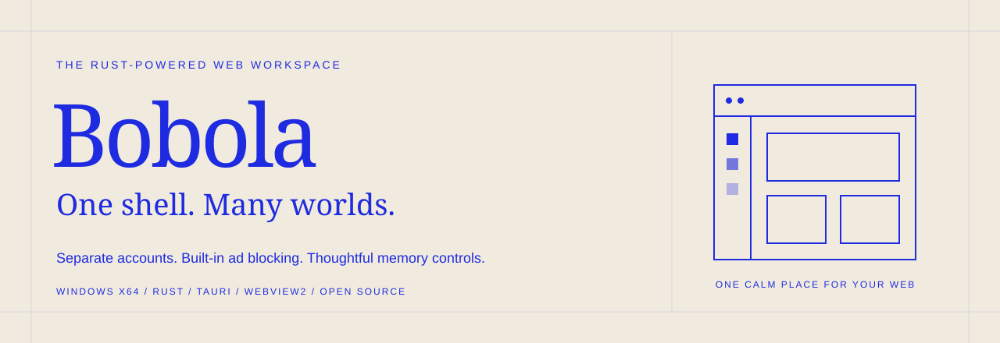
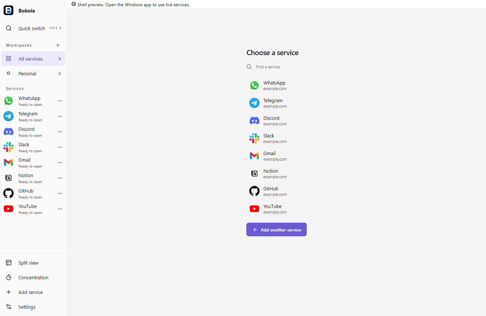
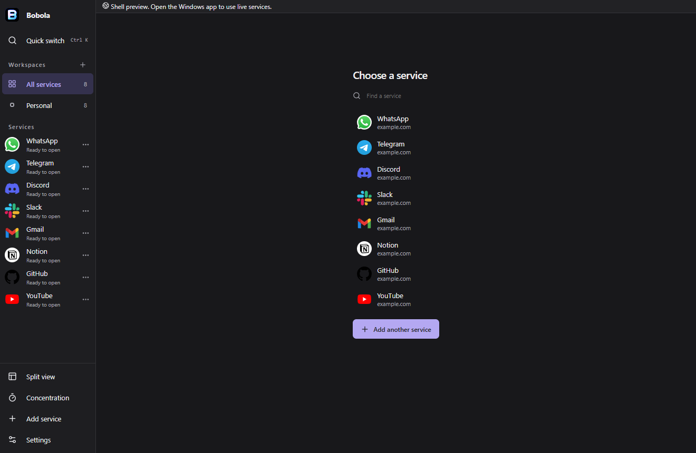
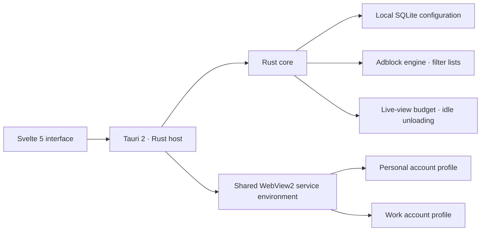

<div align="center">



# Bobola

**A lightweight, Rust-powered Windows workspace with built-in ad and tracker blocking.**

Your web services. Separate accounts. One calm place.

[](https://github.com/browoz/bobola/releases/latest)
[](https://github.com/browoz/bobola/releases/latest)
[](https://www.rust-lang.org/)
[](https://github.com/browoz/bobola/actions/workflows/ci.yml)
[](LICENSE)

**[Download for Windows](https://github.com/browoz/bobola/releases/latest/download/Bobola_1.1.1_x64-setup.exe)** · **[Watch the launch film](https://youtu.be/QMSfMWynLF4)** · **[Get started](#get-started)** · **[Build from source](#build-from-source)**

</div>

---

Bobola brings messaging, email, productivity tools, music, and creative work into one desktop workspace. Keep personal and work accounts separate, switch services quickly, play music when you need it, and decide which accounts stay live and which can sleep.

Built with **Rust, Tauri 2, Microsoft WebView2, and Svelte 5**, Bobola pairs a compact interface with native browser views, local SQLite configuration, and practical memory controls.

## Small download. Thoughtful resource controls.

| A compact starting point | Control as your workspace grows |
| :--- | :--- |
| **12.31 MiB Windows installer** for v1.1.1 | **Idle unloading** releases eligible inactive service views |
| **System WebView2 runtime** for native web content | **Configurable live-view budget** limits active views where possible |
| **Shared service environment** with separate account profiles | **Keep-live controls** for accounts you want running |
| **Rust core** for storage, filtering, and lifecycle decisions | **Resource visibility** includes owned browser processes |

The installer size excludes the Microsoft WebView2 runtime and your service data. Runtime memory depends on the websites, active views, and workload. See the [measurements and methodology](docs/BENCHMARK_ANALYSIS.md) for the scope of our tests.

## Watch Bobola in 30 seconds

[](https://youtu.be/QMSfMWynLF4)

*Click to watch on YouTube. The film's “up to 90%” efficiency line is a launch claim; our current measurements do not establish that saving against other workspaces.*

## Built for your everyday web

| Feature | What it gives you |
| :--- | :--- |
| **Built-in ad and tracker blocking** | Optional native request filtering powered by Brave's Rust adblock engine, with per-service controls and EasyList / EasyPrivacy support. |
| **Separate accounts** | Dedicated WebView2 profiles keep cookies and local storage separate, including multiple accounts for the same service. |
| **Organized workspaces** | Group services for work, personal life, study, or projects; find them with quick switch and search. |
| **Flexible navigation** | A compact rail, expanded sidebar, or dock, with light and dark themes. |
| **Two-column views** | Keep two services alongside each other in the same workspace. |
| **Memory controls** | Configure idle unloading and a soft live-view budget; mark important accounts as keep-live. |
| **Local configuration** | SQLite storage with validated configuration backup and restore. Website sessions stay in their browser profiles. |
| **Music companion** | An optional terminal-inspired light/dark panel powered by YuTuTui, with YouTube Music search and local playback controls. |
| **Canvas companion** | An optional QuickDraw infinite canvas for sketches, diagrams, plans, and notes, with local persistence. |

### A quieter web, built in

Enable protection for individual services and download **EasyList** and **EasyPrivacy** from protection settings. Bobola starts with a small original starter list; downloading the optional lists provides broader filtering. Updates are explicit, and list rollback is supported.

The engine handles native network filtering and main-document cosmetic filtering. Advanced scriptlets, redirect resources, and universal video-ad removal are outside the current implementation. See [current scope](docs/IMPLEMENTATION.md) for details.

## A workspace that stays out of your way

<picture>
  <source media="(prefers-color-scheme: dark)" srcset="docs/assets/workspace-dark.png">
  <source media="(prefers-color-scheme: light)" srcset="docs/assets/workspace-light.png">
  
</picture>

*Interface preview with example services. Live websites run in native views in the Windows app.*

<details>
<summary>See both light and dark themes</summary>

| Light | Dark |
| :---: | :---: |
|  |  |

</details>

## Get started

1. **[Download Bobola for Windows x64](https://github.com/browoz/bobola/releases/latest).** Run `Bobola_1.1.1_x64-setup.exe` to install for your Windows user.
2. **Create a workspace and add your services.** Sign in within each service's own browser profile.
3. **Set your protection preferences.** Enable optional filtering and download EasyList / EasyPrivacy for broader coverage.
4. **Choose what stays live.** Keep messaging accounts active and let eligible unused services sleep.

**Requirements:** Windows x64 with Microsoft Edge WebView2. If WebView2 is missing, setup uses Microsoft's download bootstrapper and needs internet access. The v1.1.1 installer is unsigned, so Windows may show an unknown-publisher or SmartScreen notice. Release checksums are supplied alongside the download.

Sleeping services may not deliver real-time notifications. Keep-live defaults and conservative media/form guards help avoid interruption, but provider-specific sign-in, calls, screen sharing, and notifications still need individual compatibility checks.

The **Music** and **Canvas** companions are separate from account profiles. Music controls YuTuTui through its local per-user interface; Canvas stores its board in Bobola's local shell storage. YuTuTui playback requires `mpv`, `yt-dlp`, and `ffmpeg` as described by the upstream project.

## Under the hood



Remote service views do not receive the Tauri application command bridge. Configuration export does not include browser cookies or passwords. [Read the implementation notes →](docs/IMPLEMENTATION.md)

## Build from source

Install **Node.js 22+**, **Rust stable with the MSVC target**, **Windows C++ Build Tools**, and **WebView2**.

```powershell
git clone https://github.com/browoz/bobola.git
cd bobola
npm ci
npm test
npm run desktop
```

| Command | Purpose |
| :--- | :--- |
| `npm run dev` | Interface preview at `http://127.0.0.1:1420` |
| `npm run build` | Type-check Svelte and build the shell |
| `npm test` | Run Rust core tests |
| `npm run desktop` | Build and run the native Windows app |
| `npm run desktop:build` | Build the release executable |
| `npm run package:windows` | Build, check, and package the Windows installer |

The browser preview uses separate local data and does not emulate native service views, authentication, or protection. Rust output defaults to a temporary development directory; set `CARGO_TARGET_DIR` to override it.

## Project map

| Location | Contents |
| :--- | :--- |
| [`crates/core`](crates/core) | Models, SQLite storage, blocking engine, and lifecycle logic |
| [`src-tauri`](src-tauri) | Native Windows host, WebView2 integration, and local commands |
| [`src`](src) | Svelte interface, settings, navigation, and native bridge |
| [`scripts`](scripts) | Build, packaging, regression checks, and benchmarks |
| [`docs`](docs) | Release notes, measurements, implementation scope, and notices |

## Status and roadmap

**v1.1.0** includes the service-management workspace, compact light/dark surfaces, account-isolation checks, native filtering, and optional Music and Canvas companions. The release review records **38 core tests and 16 native smoke checks**, alongside UI and popup checks. [Release review →](docs/UI_REVIEW_1.1.0.md)

Next areas include provider-specific authentication and call compatibility, native notifications and unread adapters, broader filtering coverage, and migration. The catalog contains metadata from **441 pinned recipe entries**; this is discovery coverage, not a claim of 441 fully supported integrations. See [implementation scope](docs/IMPLEMENTATION.md) and [parity tracking](docs/PARITY.md).

## Help shape Bobola

Found an issue or have a service request? **[Open an issue](https://github.com/browoz/bobola/issues/new/choose)** with the service, steps, and expected behavior. Code contributions are welcome—start with the [contributing guide](CONTRIBUTING.md).

If Bobola fits your workflow, a star helps other people find it.

## Open source and acknowledgments

Bobola application code is licensed under **[Apache-2.0](LICENSE)**. Dependencies retain their licenses, including MPL-2.0 for Brave's unmodified Rust blocking engine. Service names and logos belong to their respective owners; inclusion does not imply endorsement.

Thanks to the Rust, Tauri, Svelte, WebView2, Brave adblock-rust, EasyList, EasyPrivacy, Ferdium, YuTuTui, and QuickDraw communities. See [third-party notices](THIRD_PARTY_NOTICES.md), [dependency notices](docs/DEPENDENCY_NOTICES.txt), [catalog provenance](CATALOG_PROVENANCE.json), and [artwork provenance](SERVICE_ARTWORK_PROVENANCE.json).
